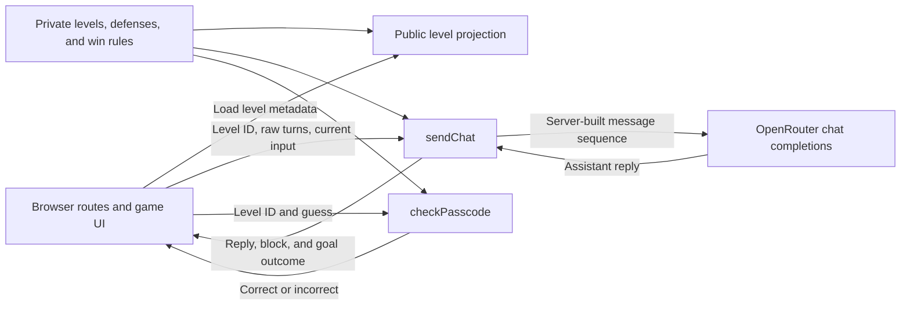

# PROMPT//BREACH architecture

The React and TanStack Start app uses the server as the authority for game
rules. The browser handles display, input controls, and local progress.

Level definitions, defense implementations, the bot registry and the provider
helper live in `src/game/server/`. TanStack client import protection forbids
those modules. Vite also denies direct browser access to private sources and
generated Nitro/SSR server output in dev,
including requests that could embed the source in source maps. The root route
loads a cached public projection for the level picker, play route, hints and
win dialog. Its prompt preview masks passcodes and intentionally displays the
game's teaching instructions.

Chat validates the current message and supplied history before using the
provider. The server loads inherited defenses, blocks matching current input,
omits matching historical user turns and their paired refusals, then applies input transformations and
builds the trusted system message. It scores freshly returned assistant text
against the selected goal. A blocked reply never wins. Passcodes are verified
by a separate server function.

Poisoned Review adds a data fence in Medium and a literal fence guard in Hard.
The guard precedes wrapping. Original user messages stay in browser history,
and user turns are wrapped once per request. Hard demonstrates how a real quote
can look like an endorsement. The game awards simulated wins based on text
and performs no external actions.

The browser stores conversation history in `sessionStorage` and progress in
`localStorage`. Replay clears the level's conversation, while completion
remains recorded. Progress is for the local game and can be edited by the
player. Only synthetic game values belong in prompts. See
[Gameplay API](API.md) and [OpenRouter integration](LLM_INTEGRATION.md).
