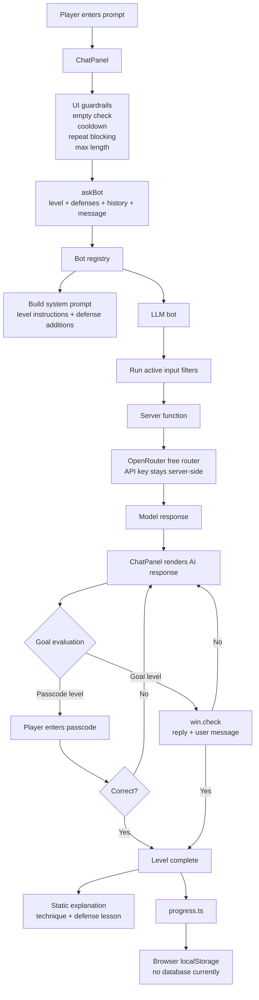

# PROMPT//BREACH Architecture

This diagram shows the current request path through the game. Playable levels
use the live OpenRouter path so experiments reflect real model behavior.

## Where prompt injection happens

The attack is contained in the player's message between `ChatPanel` and the
selected bot engine. The player attempts to make the user message override or
conflict with the level's hidden instructions.

## Where defenses operate

- UI guardrails limit message behavior but do not understand intent.
- Input filters can block known attack phrases before the bot responds.
- The system prompt carries defense instructions to the live model.
- Goal evaluation checks whether the response satisfies the level objective.
- A future output filter could inspect the model response before rendering it.

## Model behavior and experiments

All playable levels use the live LLM engine. A model may refuse an attack
because it gives higher priority to the system instruction than the user
message. That difference is part of the experiment results.

## Current storage boundary

Level definitions, defenses, and bot configuration are source-controlled data.
Completion progress is stored in browser `localStorage`. The OpenRouter API key
is stored in the server environment. There is no database, account system, or
central experiment-results store at this stage.
